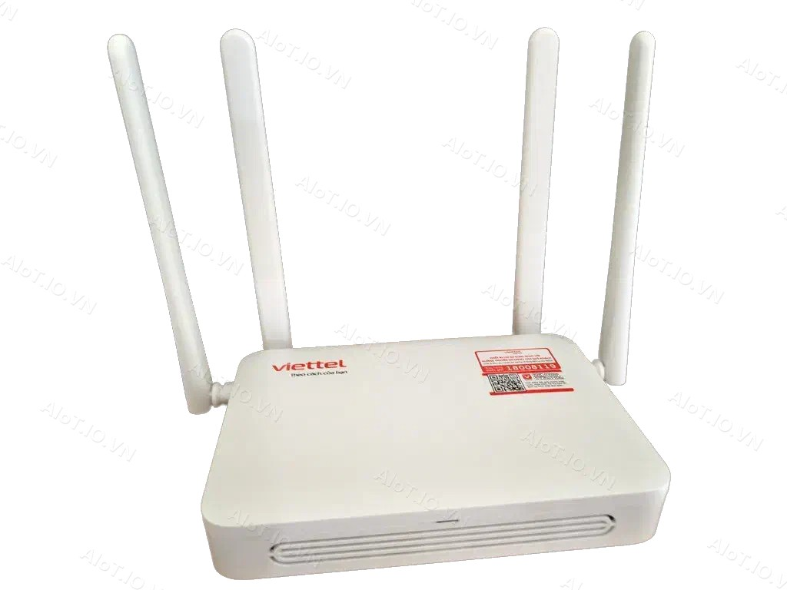
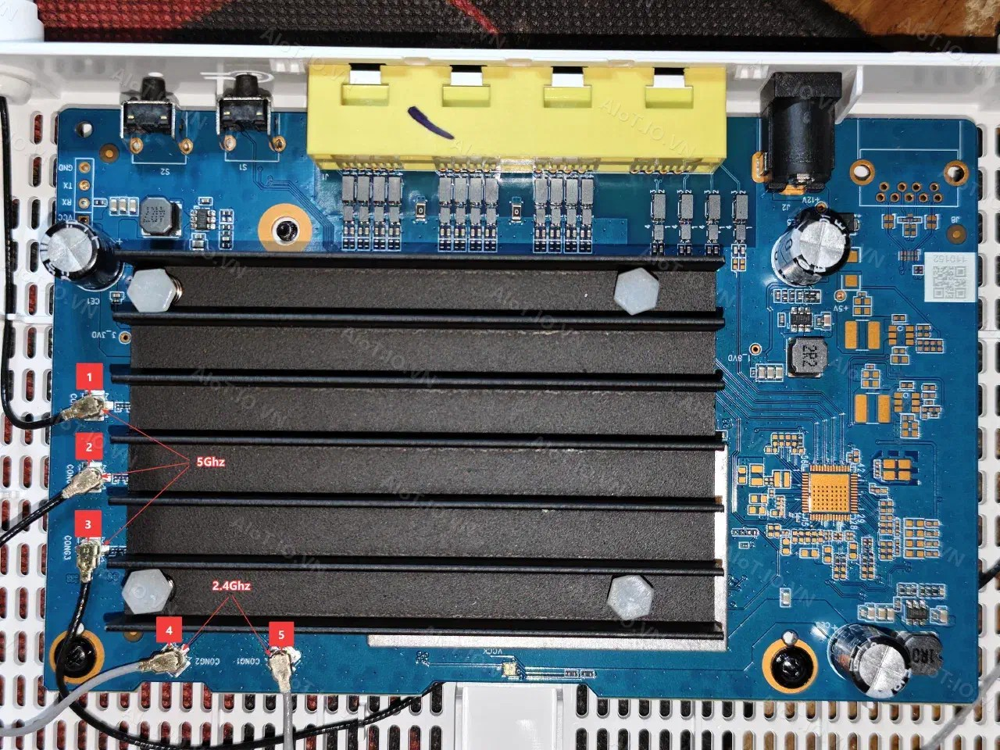
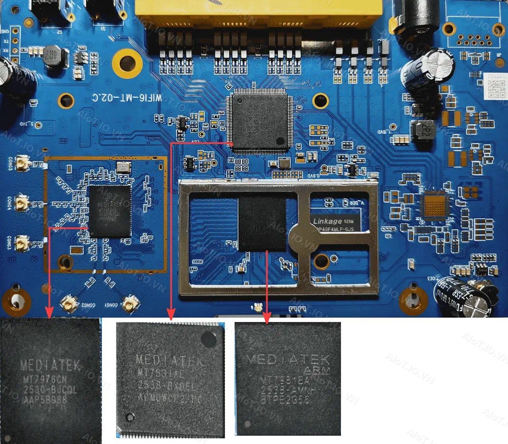
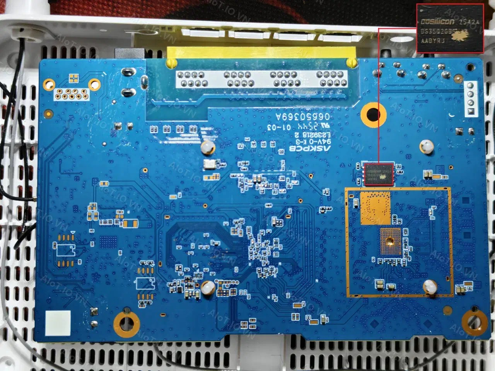
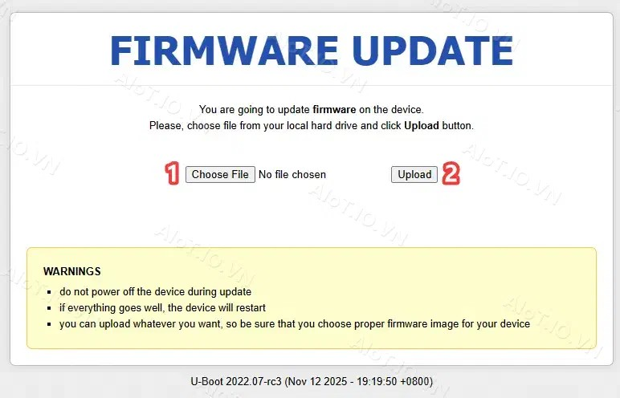

# Viettel SDMC NR3053 — OpenWrt / ImmortalWrt Guide

Documentation, hardware teardown photos, and flashing guides for installing **OpenWrt 24.10**, **ImmortalWrt 25.12**, or **KeeneticOS** on the **Viettel SDMC NR3053** Wi-Fi 6 (AX3000) router.

> [!TIP]
> **Bilingual Documentation & Interactive 256 MiB Flash Map:** View the GitHub Pages site at **[https://kreier.github.io/nr3053/](https://kreier.github.io/nr3053/)** (**English**, default) or **[https://kreier.github.io/nr3053/vi/](https://kreier.github.io/nr3053/vi/)** (**Tiếng Việt**), built from [`site/`](site/) via [`.github/workflows/pages.yml`](.github/workflows/pages.yml).



---

## Hardware Overview & Teardown

Manufactured by **Shenzhen SDMC Technology Co., Ltd.** for Viettel, the NR3053 offers strong hardware for OpenWrt/ImmortalWrt:

| Component | Specification | Notes |
| --- | --- | --- |
| **SoC / CPU** | MediaTek **MT7981BA** (Filogic 820) | Dual-core ARM Cortex-A53 @ 1.3 GHz, HNAT / WED |
| **RAM** | **512 MiB** DDR3L | Linkage `4GF4MLF-GJS` (4 Gbit) |
| **SPI NAND Flash** | **256 MiB** SPI NAND | Dosilicon `DS35Q2GBS` (2 Gbit, WSON-8, 128 KiB erase block, 2 KiB page, 128 B OOB, 8-bit ECC) |
| **Wi-Fi 6 RF** | MediaTek **MT7976CN** | AX3000 (2.4 GHz 574 Mbps + 5 GHz 2402 Mbps @ 160 MHz, internal FEMs) |
| **Ethernet Switch** | MediaTek **MT7531AE** | 4× Gigabit RJ45 (`1 WAN + 3 LAN`), `2500base-x` CPU link |
| **Antennas** | 4× external 5 dBi | 5 RF leads on PCB: 3× 5 GHz (`CONG3–5`) + 2× 2.4 GHz (`CONG1–2`) |
| **Serial Debug** | 4-pin **3.3 V TTL UART** | Clearly silkscreened `GND`, `TX`, `RX`, `VCC` @ `115200 8N1` |
| **Buttons / LEDs** | WPS/Mesh (GPIO 0), Reset (GPIO 1) | Status LED Green (GPIO 4) / Red (GPIO 6), active-low |

### Inside the Router

| Front PCB (Heatsink, 5× RF Leads & Exposed UART) | Core ICs (`MT7981BA`, `MT7531AE`, `MT7976CN`, 512 MiB RAM) |
| :---: | :---: |
|  |  |

| Back PCB (`Dosilicon DS35Q2GBS` 256 MiB SPI NAND) | Stock U-Boot 2022.07-rc3 Web Failsafe |
| :---: | :---: |
|  |  |

*Teardown and U-Boot Web Failsafe photos sourced from [AIoT.IO.VN (Ng Nghia Phan)](https://aiot.io.vn/serial/disassemble/kham-pha-phan-cung-viettel-nr3053/).*

---

## Verified Stock Partition Layout & Contents (`mtd0`–`mtd11`)

Verified from live NR3053 hardware (stock OpenWrt `21.02-SNAPSHOT r0-855a6718f`, Linux `5.4.194 aarch64`, `U-Boot 2022.07-rc3 (Sep 20 2025)`, Dosilicon `DS35Q2GBS` `2048 B` page / `128 KiB` erase block / `128 B` OOB / `8-bit` ECC / `0` bad blocks) using [`scripts/nr3053_helper.py`](scripts/nr3053_helper.py):

| MTD | Name | Address Range | Size | Used (Non-FF) | Fill % | Verified Content & Notes |
| --- | --- | --- | ---: | ---: | ---: | --- |
| `mtd0` | `spi0.0` | `0x00000000`–`0x10000000` | 256.00 MiB | — | — | Whole raw SPI NAND chip |
| `mtd1` | `BL2` | `0x00000000`–`0x00100000` | 1.00 MiB | 223.9 KiB | 21.9% | MediaTek BL2/BRLYT header (span 232.7 KiB) |
| `mtd2` | `u-boot-env` | `0x00100000`–`0x00200000` | 1.00 MiB | 1,024.0 KiB | 100.0% | Zero-padded U-Boot env (`crc_ok=True`: `upgrade_result=0`, `bootimage=2`) |
| `mtd3` | `Factory` | `0x00200000`–`0x00400000` | 2.00 MiB | 640.0 KiB | 31.2% | MT7981 RF EEPROM (`magic=0x7981`) & MACs (**≡ `mtd9`**) |
| `mtd4` | `FIP` | `0x00400000`–`0x00600000` | 2.00 MiB | 713.3 KiB | 34.8% | TF-A FIP TOC `@0x0`, `U-Boot 2022.07-rc3` (span 731.8 KiB, **≡ `mtd10`**) |
| `mtd5` | `firmware` | `0x00600000`–`0x02600000` | 32.00 MiB | 16.30 MiB | 50.9% | `ubi0` (256 PEBs): `kernel` (6.0 MiB) + `rootfs` (20.1 MiB, SquashFS `@0x3c1000`, **≡ `mtd6`**) |
| `mtd6` | `firmware2` | `0x02600000`–`0x04600000` | 32.00 MiB | 16.30 MiB | 50.9% | `ubi1` (256 PEBs): mirrored firmware slot (active when `bootimage=2`, **≡ `mtd5`**) |
| `mtd7` | `rootfs_data` | `0x04600000`–`0x0d400000` | 142.00 MiB | 7.62 MiB | 5.4% | `ubi2` (1,136 PEBs): `rootfs_data` UBIFS (128.1 MiB, mounted `/overlay`) |
| `mtd8` | `rootfs_data_backup` | `0x0d400000`–`0x0ec00000` | 24.00 MiB | 688.9 KiB | 2.8% | `ubi3` (192 PEBs): `rootfs_data_backup` (18.0 MiB; distinct from `mtd7`) |
| `mtd9` | `Factory_backup` | `0x0ec00000`–`0x0ee00000` | 2.00 MiB | 640.0 KiB | 31.2% | Redundant copy of `Factory` (**SHA-256 identical to `mtd3`**) |
| `mtd10` | `fip2` | `0x0ee00000`–`0x0f000000` | 2.00 MiB | 713.3 KiB | 34.8% | Redundant copy of `FIP` (**SHA-256 identical to `mtd4`**) |
| `mtd11` / — | `reserved` (NMBM) | `0x0f000000`–`0x10000000` | 16.00 MiB | — | — | `mtd11` reports `0 B`; upper 16 MiB reserved by MediaTek NMBM / BBT |

### Backing Up & Inspecting Partitions (`scripts/nr3053_helper.py`)

[`scripts/nr3053_helper.py`](scripts/nr3053_helper.py) (Python 3 standard library only, read-only) supports both **Telnet (port 23)** and **SSH (port 22)** to probe hardware, stream all partitions directly to a Linux host without filling router `/tmp` RAM, verify SHA-256 checksums, and inspect dumps offline:

```bash
python3 scripts/nr3053_helper.py probe --host 10.1.1.1
python3 scripts/nr3053_helper.py backup --host 10.1.1.1 --out ./backups/nr3053-stock --7z
python3 scripts/nr3053_helper.py inspect-backup ./backups/nr3053-stock
```

---

## Installation Paths

### 1. Stock Web Failsafe (No SSH Required — Easiest)

Stock U-Boot (`2022.07-rc3`) includes a built-in Web Failsafe server:

1. Unplug power, connect PC to a **LAN** port, hold **MESH** (WPS), and plug power back in for ~5 seconds until the LED turns from red to **solid green**.
2. Set PC static IP to `192.168.1.2/24` and open `http://192.168.1.1/`.
3. Upload a stock-U-Boot-compatible **OpenWrt 24.10** image (`openwrt-mediatek-filogic-viettel_nr3053-stock-squashfs-factory_fix.bin`), verify MD5, and click **Update**.
   *(Alternatively, flash the custom ImmortalWrt `.fip` via `http://192.168.1.1/uboot.html`, then set PC IP to `192.168.1.254/24` and upload `squashfs-sysupgrade.itb`.)*

### 2. Unlock SSH & Install ImmortalWrt 25.12 (234 MiB Native UBI)

1. Perform a **factory reset** (hold `Reset` > 10 s until the LED turns off and back on). The stock web password becomes the **Serial Number (S/N)** printed on the bottom label.
2. Unlock SSH with [`quytttb/nr3053-tools`](https://github.com/quytttb/nr3053-tools):
   ```bash
   git clone https://github.com/quytttb/nr3053-tools.git
   cd nr3053-tools
   pip3 install -r requirements.txt
   python3 unlock_nr3053.py --password YOUR_SERIAL_NUMBER
   ```
3. Log in (`ssh root@192.168.1.1`, password `admin`), back up `mtd1`–`mtd4` (**especially `mtd3` `Factory`**), copy `immortalwrt-mediatek-filogic-viettel_nr3053-bl31-uboot.fip` to `/tmp/fip.bin`, and flash it:
   ```sh
   mtd write /tmp/fip.bin FIP
   sync && reboot
   ```
4. Set PC static IP to **`192.168.1.254/24`**, open `http://192.168.1.1/`, and flash `immortalwrt-mediatek-filogic-viettel_nr3053-squashfs-sysupgrade.itb`.

> [!WARNING]
> **Never erase the `Factory` partition (`0x200000`, 2 MiB)** — it stores your unique Wi-Fi RF calibration EEPROM and Ethernet MAC addresses.

---

## Firmware & Community Sources

### ImmortalWrt 25.12 (v2.5.0)
- [`quytttb/immortalwrt-mt798x-rebase`](https://github.com/quytttb/immortalwrt-mt798x-rebase) — latest `v2.5.0` (2026-10-30, includes USB-mod support) and [`v2.4.5`](https://github.com/quytttb/immortalwrt-mt798x-rebase/releases/tag/v2.4.5) (2026-10-16)
- Bootloader source: [`quytttb/bl-mt798x-dhcpd`](https://github.com/quytttb/bl-mt798x-dhcpd)
- Wi-Fi Roaming (802.11r/k/v) & SQM Anti-Bufferbloat tuning: [hashcott Gist](https://gist.github.com/hashcott/68e337ac52f3410e6d19a177fb5bc1bf)

### OpenWrt 24.10 (Stock-U-Boot Compatible)
- [AIoT.IO.VN — Flash OpenWrt without SSH](https://aiot.io.vn/firmware/viettel/viettel-sdmc-nr3053-posts/h%C6%B0%C6%A1ng-dan-flash-openwrt-khong-can-mo-ssh-nr3053/) (2026-10-21)
- [AIoT.IO.VN — Unlock SSH & Flash Guide](https://aiot.io.vn/firmware/viettel/viettel-sdmc-nr3053-posts/huong-dan-mo-ssh-flash-firmware-rn3053/) (2026-10-16)
- [AIoT.IO.VN — Hardware Teardown](https://aiot.io.vn/serial/disassemble/kham-pha-phan-cung-viettel-nr3053/) (2026-10-14)

### KeeneticOS 5.01 (DIY Port)
- [`linhsayshii/keeneticos-nr3053`](https://github.com/linhsayshii/keeneticos-nr3053) — SDK patches & [Bootloader `v32`](https://github.com/linhsayshii/keeneticos-nr3053/releases/tag/v32) (2026-10-20)

### Upstream OpenWrt (`ubootmod`) Roadmap
- [docs/upstream-openwrt-roadmap.md](docs/upstream-openwrt-roadmap.md) — Hardware unbrick (`BootROM` + `mtk_uartboot`), stock-revert notes, bootloader comparison, and the 8-step roadmap to build and submit official upstream OpenWrt `mediatek/filogic` (`ubootmod` + Native UBI with built-in `recovery` volume) support.

---

## Building the GitHub Pages Site Locally

Requires Python 3 (standard library only, zero external packages):

```bash
python3 site/build.py
python3 -m http.server -d site/dist 8000
```
